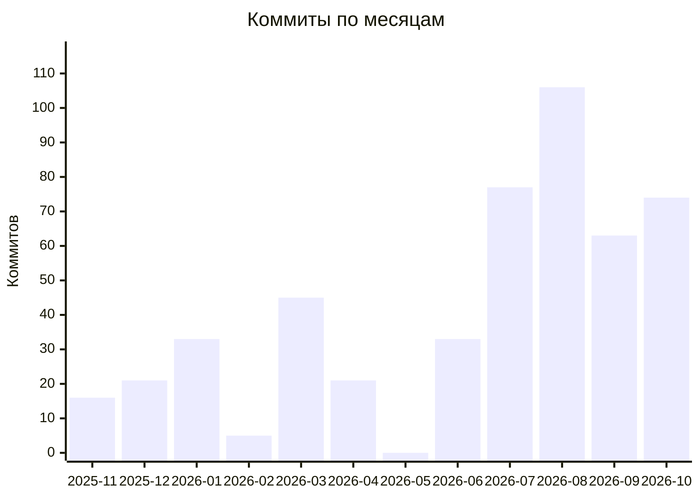

  

  <code><strong>MA</strong>king comp<strong>LEX</strong> sim<strong>PLE</strong></code>

  <em>Каждый проект здесь — это мостик между сложностью реального мира и удобством использования.</em>

---

## 🧭 Манифест

Я верю, что хорошая инженерия — это **упрощение**, а не усложнение. Поэтому мои проекты решают одну задачу: взять что-то запутанное (протокол, формат, систему, концепцию) и сделать это доступным через понятный интерфейс или работающий код.

Я не рассматриваю каждый проект как обязательную часть единой продуктовой экосистемы. Часть инструментов приносит доход, часть остаётся исследовательскими прототипами, часть — личными утилитами. Все они ценны, потому что помогают мне понимать, как устроен мир.

---

## 🚀 Работает в продакшене

Сервисы с реальными пользователями и живыми метриками — можно потрогать прямо сейчас.

<table>
<tr>
<td width="50%">

### 📚 Book Metadata Service

**[bookmetadata.ru](https://bookmetadata.ru)** — открытый каталог книжных метаданных.

- 📖 **2083+ книг** и **1 629+ авторов** в базе
- 🔑 Бесплатный API без регистрации и ключей
- 🔀 Open Library + Google Books + FantLab → одна карточка

Попробовать: `curl "https://bookmetadata.ru/api/v1/search/isbn/9785389143852"`

</td>
<td width="50%">

### 🧠 Scanner Profile

**[Пройти тест](https://malexple-scanner-profile.hf.space/)** — тип по Барбаре Шер + гении по Ленсиони.

- 👥 **1 053 человека** начали, **255** прошли до конца
- 📈 Конверсия 24.2% · [публичная статистика](https://malexple-scanner-profile.hf.space/stats?lang=ru)
- 🌍 3 языка: RU / EN / 中文 · 🤗 Hugging Face Spaces

</td>
</tr>
</table>

Метрики сервисов — по состоянию на сентябрь 2026.

---

## 🔬 Как я работаю

### Цикл познания

Мой подход к любой задаче следует повторяющемуся циклу:

1. **Собрать информацию** — изучаю тему с разных сторон, ищу примеры и альтернативные решения
2. **Сформировать модель** — строю внутреннее представление задачи, нахожу ограничения и ключевые принципы
3. **Найти архитектуру** — ищу готовые паттерны или создаю новые, которые можно переиспользовать
4. **Быстро реализовать** — создаю работающий прототип, чтобы проверить гипотезу
5. **Проверить и исправить** — тестирую, нахожу ограничения, исправляю ошибки
6. **Сохранить знания** — документирую решения и компоненты для будущих задач

### Сильные стороны

| Сильная сторона | Как проявляется |
|---|---|
| **Быстрое прототипирование** | Могу за часы или дни создать работающий вариант сложной системы (например, перенёс язык программирования с DOS на современную платформу за 9 часов генерации + неделя проверки) |
| **Поиск общих принципов** | Вижу архитектурные решения и закономерности, которые можно переиспользовать в разных проектах (Pivot-архитектура, shared core, модульные системы) |
| **Самостоятельное изучение** | Осваиваю новые области (от квантовой физики до биомеханики) через код и эксперименты, а не только через чтение |
| **Длительная настойчивость** | Могу преследовать значимую цель годами, пробуя разные методы достижения |
| **Автономность** | Работаю самостоятельно, выбираю направления и методы, не стремлюсь автоматически превращать техническую деятельность в управление командой |
| **Создание инструментов** | Когда существующие решения не подходят моему способу работы, создаю собственные утилиты, фреймворки и инфраструктуру |
| **Интерес к фундаментальному** | Меня привлекают вопросы устройства материи, когнитивных архитектур, космических технологий — не только прикладные задачи |

### Многопроектность

Я работаю циклически, спринтами по несколько дней или недель, переключаясь между направлениями и возвращаясь к ним. Это естественная часть моего способа работы, а не признак незавершённости. Проекты могут быть:

- **Production-сервисами** (работают годами, приносят пользу пользователям)
- **Исследовательскими прототипами** (проверяют гипотезы, могут быть заморожены после получения ответа)
- **Личными инструментами** (решают мои задачи, не предназначены для широкой аудитории)
- **Экосистемами** (связанные проекты, которые вместе решают большую проблему)

---

## 📚 Хаос метаданных → Чистый API

*Проблема: разрозненные библиотечные каталоги, неструктурированные PDF, ручная работа*

| Проект | Как упрощает | Стек |
|--------|--------------|------|
| [**book-metadata-service**](https://github.com/malexple/book-metadata-service) · 🌐 [live](https://bookmetadata.ru) | Один REST API вместо десяти сайтов. Open Library + Google Books + FantLab → одна карточка книги | Java, Spring Boot |
| [**fondoscan**](https://github.com/malexple/fondoscan) | Автоматическая экстракция из PDF/DjVu: OCR + сверка с Library of Congress. Человек только подтверждает | Java, Tesseract |
| [**udk-book-scanner**](https://github.com/malexple/udk-book-scanner) | Парсит коды УДК из сканов — библиотекарь больше не вводит их вручную | Java |
| [**udk-site-parser**](https://github.com/malexple/udk-site-parser) | Иерархия кодов УДК с сайта → готовая структура для импорта | Java |
| [**bdoc-editor**](https://github.com/malexple/bdoc-editor) | Верстка книг без InDesign: desktop-редактор для реставраторов и малых издательств | JavaFX |
| [**sopds**](https://github.com/malexple/sopds) | Домашняя коллекция PDF → OPDS-каталог для читалки | Java |
| [**obsidian-book-search-plugin**](https://github.com/malexple/obsidian-book-search-plugin) | ISBN → готовая заметка в Obsidian с обложкой и описанием | TypeScript |

---

## 🛡 Криптография → Одно нажатие

*Проблема: протоколы с key exchange, WebSocket, nonce — сложно для конечного пользователя*

| Проект | Как упрощает                                                                                                                                      | Стек |
|--------|---------------------------------------------------------------------------------------------------------------------------------------------------|------|
| [**keepasshttp2**](https://github.com/malexple/keepasshttp2) | KeePassXC-Browser протокол на C# без зависимостей: crypto_box + WebSocket внутри одного DLL                                                       | C#, NaCl |
| [**keepasshttp2-browser**](https://github.com/malexple/keepasshttp2-browser) | Пользователь просто кликает на иконку — пароль вставляется. Вся криптография под капотом                                                          | TypeScript |
| [**keepass-copy-key**](https://github.com/malexple/keepass-copy-key) | Плагин для удобного импорта и экспорта паролей в KeePass. Вся криптография под капотом | C#, NaCl |
| [**openvpn-agent**](https://github.com/malexple/openvpn-agent) | `/new-client vpn` в Telegram → готовый .ovpn файл. Никаких SSH и конфигов                                                                         | Java |

---

## 🛠 Сырые инструменты → Визуальные интерфейсы

*Проблема: JSON-файлы, CLI-утилиты, консоль — страшно для QA и команды*

| Проект | Как упрощает | Стек |
|--------|--------------|------|
| [**web-wiremock**](https://github.com/malexple/web-wiremock) | WireMock через drag-and-drop UI: мастер стабов, сценарии, профили, журнал запросов | Java, Spring Boot |
| [**wiremock-js-extension**](https://github.com/malexple/wiremock-js-extension) | Вместо Java-трансформеров — простые JS-скрипты с понятным whitelist API | Java, ANTLR |
| [**ai-proxy**](https://github.com/malexple/ai-proxy) | Один URL для всех LLM-провайдеров. Geo-блоки и ключи — через ENV, без кода | Java, Docker |
| [**openapi-designer**](https://github.com/malexple/openapi-designer) | Дизайнер OpenAPI спецификаций в удобном UI | Java, HTML |
| [**sysmon**](https://github.com/malexple/sysmon) | Диагностика Windows **без админ-прав**: portable .jar → CSV с топ-процессами | Java |
| [**mermaid-app**](https://github.com/malexple/mermaid-app) | Mermaid.js с визуальным редактором, темами и экспортом в SVG/PNG | Java, CodeMirror |
| [**idea-platform**](https://github.com/malexple/idea-platform) | Идеи из чатов → структурированная воронка с SLA и gamification | Java, PostgreSQL |
| [**scanner-profile**](https://github.com/malexple/scanner-profile) · 🌐 [live](https://malexple-scanner-profile.hf.space/) | Сложные психологические модели (Шер, Ленсиони) → простой тест на 15 минут | Java, HuggingFace |

---

## 🔬 Загадки → Понятные ответы

*Проблема: мистика, интерференция, "необъяснимое"*

| Проект | Как упрощает | Стек |
|--------|--------------|------|
| [**quant**](https://github.com/malexple/quant) | Квантовое поле через одно уравнение: видишь рождение и аннигиляцию частиц мышкой | Java, Swing |
| [**moon**](https://github.com/malexple/moon) | "Космическая музыка" Apollo-10: разобрал на 4 физических слоя скриптами на Python | Python |

---

## 🧪 Новые языки → Минимальный синтаксис

*Проблема: сложные спецификации, тяжелые компиляторы*

| Проект | Как упрощает | Стек |
|--------|--------------|------|
| [**ellochka-zig**](https://github.com/malexple/ellochka-zig) | Язык Ellochka (1999): 62 оператора реализованы на Zig, с графикой и играми | Zig |
| [**alifba**](https://github.com/malexple/alifba) | Язык Älifba для DOS: ~4 КБ, сингармонизм суффиксов, всё в одном .COM файле | Assembly |
| [**dex-linux**](https://github.com/malexple/dex-linux) | Linux на Android одним кликом: Proot + Wayland, без рута и конфигов | Rust |
| [**rust-portable**](https://github.com/malexple/rust-portable) | Rust без `rustup`: запустил скрипт — и пишешь код | Shell, Batch |

---

## 🧠 Нейронаука и биомеханика

<!-- PROJECTS_TABLE_START: Нейронаука и биомеханика -->

### 🗣️ neuro-larynx

**Физиологическая модель голоса с биологически правдоподобным нейроуправлением**

**Что делает:** Модель голоса с биологически правдоподобным нейроуправлением. Проект написан на Java 21 с использованием Gradle и пакета ru.mcs.larynx, поддерживает интеграцию с внешним ядром через параметр сборки.

**Какую боль закрывает:** Решает задачу имитации голосообразования на основе физиологических принципов и биологического нейроуправления, отличаясь от стандартных синтезаторов речи.

#### 📊 Оценки проекта

| Показатель | Значение | Комментарий |
|------------|----------|-------------|
| 🔬 Научная сложность | 6/10 | Биологическое нейроуправление и физиология голоса |
| 🛠 Техническая сложность | 5/10 | Java 21, Gradle, модульная сборка с параметрами |
| 💡 Оригинальность | 6/10 | Биологически правдоподобный подход к голосу |
| 🎯 Амбициозность | 5/10 | Комплексная физиологическая модель |

Оценки сгенерированы ИИ по README и ROADMAP проекта

#### ⚡ Скорость работы

| Метрика | Значение | Статус |
|---------|----------|--------|
| 🔄 Коммитов в день | 1.0 | 🟢 2.0x быстрее среднего |
| 💻 Строк кода в день | 428 | 🟢 2.9x выше среднего |
| **⚡ Общий коэффициент** | **2.36x** | **🟢 высокая** |

**Период разработки:** 6 дн. (21 октября 2026 — 26 октября 2026)  

**Ключевые основы:** Java 21, Gradle, биологическое нейроуправление, физиологическая модель

**Особенность:** Реализует биологически правдоподобное нейроуправление голосовым аппаратом на Java.

[→ Смотреть код на GitHub](https://github.com/malexple/neuro-larynx)

<!-- PROJECTS_TABLE_END -->

---

## 📚 Метаданные книг

<!-- PROJECTS_TABLE_START: Метаданные книг -->

### 📚 book-metadata-service

**Один REST API вместо десяти сайтов. Объединение книжных метаданных**

**Что делает:** Открытый REST API для поиска и объединения книжных метаданных из разных источников в единую карточку. Сервис автоматически обогащает базу при первом запросе и поддерживает выборку полей.

**Какую боль закрывает:** Избавляет от необходимости вручную собирать данные с десятков сайтов, предоставляя единую точку входа без регистрации и ключей доступа.

#### 📊 Оценки проекта

| Показатель | Значение | Комментарий |
|------------|----------|-------------|
| 🔬 Научная сложность | 3/10 | Стандартная агрегация данных |
| 🛠 Техническая сложность | 6/10 | Spring Boot 3, EAV-модель, Docker |
| 💡 Оригинальность | 5/10 | Удобная комбинация источников |
| 🎯 Амбициозность | 5/10 | Полезный утилитный сервис |

Оценки сгенерированы ИИ по README и ROADMAP проекта

#### ⚡ Скорость работы

| Метрика | Значение | Статус |
|---------|----------|--------|
| 🔄 Коммитов в день | 0.4 | 🟡 0.8x от среднего |
| 💻 Строк кода в день | 129 | 🟡 0.9x от среднего |
| **⚡ Общий коэффициент** | **0.80x** | **🟡 средняя** |

**Период разработки:** 71 дн. (17 августа 2026 — 26 октября 2026)  

**Ключевые основы:** REST API, Open Library, Google Books, FantLab, LibGen, Sigla, SearXNG, Ollama, EAV, Force.com Multitenant Architecture, PostgreSQL, Flyway, Spring Boot 3.4, Java 21, Docker

**Особенность:** Объединение множества разрозненных книжных баз данных и парсеров в один стандартизированный интерфейс.

[→ Смотреть код на GitHub](https://github.com/malexple/book-metadata-service)

<!-- PROJECTS_TABLE_END -->

---

## 🛠 Инструменты тестирования

<!-- PROJECTS_TABLE_START: Инструменты тестирования -->

### 🎭 web-wiremock

**WireMock через визуальный интерфейс. Мастера стабов, сценарии, профили**

**Что делает:** Красивый веб-интерфейс для управления мок-сервером WireMock. Позволяет создавать стабы через пошаговые мастера, настраивать stateful-сценарии и управлять профилями без ручного редактирования JSON.

**Какую боль закрывает:** Устраняет необходимость вручную писать и редактировать громоздкие JSON-файлы WireMock, предоставляя удобную визуальную панель управления для разработчиков и тестировщиков.

#### 📊 Оценки проекта

| Показатель | Значение | Комментарий |
|------------|----------|-------------|
| 🔬 Научная сложность | 3/10 | Прикладная разработка веб-интерфейса для интеграционного тестирования. |
| 🛠 Техническая сложность | 6/10 | Стек Java 21, Spring Boot 3, Thymeleaf, интеграция по OpenFeign. |
| 💡 Оригинальность | 5/10 | Удобная визуальная обертка над существующим инструментом WireMock. |
| 🎯 Амбициозность | 5/10 | Полноценный инструмент со сценариями, импортом OpenAPI и профилями. |

Оценки сгенерированы ИИ по README и ROADMAP проекта

#### ⚡ Скорость работы

| Метрика | Значение | Статус |
|---------|----------|--------|
| 🔄 Коммитов в день | 0.1 | 🔴 0.3x от среднего |
| 📅 Выполнение плана | 0% | — |
| 💻 Строк кода в день | 366 | 🟢 2.4x выше среднего |
| **⚡ Общий коэффициент** | **1.19x** | **🟢 высокая** |

**Период разработки:** 229 дн. (12 марта 2026 — 26 октября 2026)  
**Текущий этап:** Фаза 1 — Каркас UI + реальные данные  
**Прогресс:** 0/5 этапов завершено  

**Ключевые основы:** WireMock, Spring Boot, Java, OpenFeign, Thymeleaf, Bootstrap, OpenAPI

**Особенность:** Отказ от ручного редактирования JSON в пользу пошаговых мастеров создания стабов и визуальных цепочек сценариев.

[→ Смотреть код на GitHub](https://github.com/malexple/web-wiremock)

<!-- PROJECTS_TABLE_END -->

---

## 📈 Статистика

<!-- STATS_START -->

**Проектов:** 44 · **Коммитов всего:** 797 · **Активных за 30 дн.:** 11 · **В среднем:** 41 коммитов в месяц

#### 📅 По месяцам

| Месяц | Новых проектов | Коммитов | Активных проектов |
|-------|----------------|----------|-------------------|
| 2026-10 | 6 | 74 | 11 |
| 2026-09 | 7 | 63 | 9 |
| 2026-08 | 3 | 106 | 5 |
| 2026-07 | 4 | 77 | 6 |
| 2026-06 | 0 | 33 | 4 |
| 2026-05 | 0 | 0 | 0 |
| 2026-04 | 3 | 21 | 4 |
| 2026-03 | 2 | 45 | 3 |
| 2026-02 | 0 | 5 | 2 |
| 2026-01 | 3 | 33 | 4 |
| 2025-12 | 0 | 21 | 2 |
| 2025-11 | 1 | 16 | 3 |

#### 🗂 Все проекты

| Проект | Тема | Стек | Создан | Изменён | Коммитов | Статус | ⚡ |
|--------|------|------|--------|---------|----------|--------|----|
| [**book-metadata-service**](https://github.com/malexple/book-metadata-service) | Метаданные книг | Java, HTML, Python | 31.08.2026 | 26.10.2026 | 27 | 🟢 активен | 0.80x 🟡 |
| [**web-wiremock**](https://github.com/malexple/web-wiremock) | Инструменты тестирования | JavaScript, Java, HTML | 13.03.2026 | 26.10.2026 | 29 | 🟢 активен | 1.19x 🟢 |
| [**neuro-larynx**](https://github.com/malexple/neuro-larynx) | Нейронаука и биомеханика | Java, Python | 22.10.2026 | 26.10.2026 | 6 | 🟢 активен | 2.36x 🟢 |
| [**neuro-worm**](https://github.com/malexple/neuro-worm) | — | Java | 17.10.2026 | 21.10.2026 | 28 | 🟢 активен | — |
| [**soundbox**](https://github.com/malexple/soundbox) | — | Java | 18.10.2026 | 19.10.2026 | 7 | 🟢 активен | — |
| [**malexple-blog**](https://github.com/malexple/malexple-blog) | — | HTML, CSS, JavaScript | 06.08.2024 | 16.10.2026 | 149 | 🟢 активен | — |
| [**stegobox**](https://github.com/malexple/stegobox) | — | Java | 15.10.2026 | 16.10.2026 | 5 | 🟢 активен | — |
| [**sysmon**](https://github.com/malexple/sysmon) | — | Java | 19.09.2026 | 15.10.2026 | 15 | 🟢 активен | — |
| [**scan-ocr**](https://github.com/malexple/scan-ocr) | — | Java | 15.10.2026 | 15.10.2026 | 1 | 🟢 активен | — |
| [**docker-secret-launcher**](https://github.com/malexple/docker-secret-launcher) | — | Java | 06.10.2026 | 06.10.2026 | 3 | 🟢 активен | — |
| [**nomad**](https://github.com/malexple/nomad) | — | Java, Kotlin | 30.09.2026 | 01.10.2026 | 10 | 🟢 активен | — |
| [**keepass-copy-key**](https://github.com/malexple/keepass-copy-key) | — | C#, PowerShell | 24.09.2026 | 24.09.2026 | 10 | 🟡 затишье | — |
| [**keepasshttp2-browser**](https://github.com/malexple/keepasshttp2-browser) | — | TypeScript, HTML | 22.09.2026 | 24.09.2026 | 3 | 🟡 затишье | — |
| [**keepasshttp2**](https://github.com/malexple/keepasshttp2) | — | C#, Python, PowerShell | 19.09.2026 | 24.09.2026 | 22 | 🟡 затишье | — |
| [**moon**](https://github.com/malexple/moon) | — | Python | 13.09.2026 | 13.09.2026 | 2 | 🟡 затишье | — |
| [**fondoscan**](https://github.com/malexple/fondoscan) | — | Java, Dockerfile | 02.09.2026 | 02.09.2026 | 5 | 🟡 затишье | — |
| [**alifba**](https://github.com/malexple/alifba) | — | Assembly | 12.08.2026 | 12.08.2026 | 13 | 🟡 затишье | — |
| [**ellochka-zig**](https://github.com/malexple/ellochka-zig) | — | Zig | 04.08.2026 | 11.08.2026 | 58 | 🟡 затишье | — |
| [**wiremock-js-extension**](https://github.com/malexple/wiremock-js-extension) | — | Java, ANTLR | 24.07.2026 | 02.08.2026 | 20 | 🟡 затишье | — |
| [**ai-proxy**](https://github.com/malexple/ai-proxy) | — | Java, Dockerfile | 09.07.2026 | 12.07.2026 | 15 | ⚪ заморожен | — |
| [**bdoc-editor**](https://github.com/malexple/bdoc-editor) | — | Java, CSS | 03.07.2026 | 08.07.2026 | 43 | ⚪ заморожен | — |
| [**solomon-seal**](https://github.com/malexple/solomon-seal) | — | Java | 01.07.2026 | 01.07.2026 | 10 | ⚪ заморожен | — |
| [**sopds**](https://github.com/malexple/sopds) | — | HTML, Java, CSS | 10.11.2025 | 12.06.2026 | 41 | ⚪ заморожен | — |
| [**quant**](https://github.com/malexple/quant) | — | Java | 08.04.2026 | 28.04.2026 | 12 | ⚪ заморожен | — |
| [**scanner-profile**](https://github.com/malexple/scanner-profile) | — | Java, HTML, Dockerfile | 13.04.2026 | 14.04.2026 | 8 | ⚪ заморожен | — |
| [**mermaid-app**](https://github.com/malexple/mermaid-app) | — | HTML, JavaScript, CSS | 07.04.2026 | 07.04.2026 | 2 | ⚪ заморожен | — |
| [**dex-linux**](https://github.com/malexple/dex-linux) | — | Rust, C, Python | 30.03.2026 | 30.03.2026 | 146 | ⚪ заморожен | — |
| [**idea-platform**](https://github.com/malexple/idea-platform) | — | HTML, Java, Dockerfile | 22.01.2026 | 24.02.2026 | 9 | ⚪ заморожен | — |
| [**openapi-designer**](https://github.com/malexple/openapi-designer) | — | HTML, Java, Dockerfile | 13.01.2026 | 13.01.2026 | 16 | ⚪ заморожен | — |
| [**openvpn-agent**](https://github.com/malexple/openvpn-agent) | — | Java | 11.01.2026 | 11.01.2026 | 3 | ⚪ заморожен | — |
| [**insomnia**](https://github.com/malexple/insomnia) | — | — | 19.06.2025 | 19.06.2025 | 2 | ⚪ заморожен | — |
| [**vercel-proxy**](https://github.com/malexple/vercel-proxy) | — | JavaScript | 10.04.2025 | 10.04.2025 | 18 | ⚪ заморожен | — |
| [**udk-book-scanner**](https://github.com/malexple/udk-book-scanner) | — | Java, Batchfile | 01.04.2025 | 01.04.2025 | 4 | ⚪ заморожен | — |
| [**udk-site-parser**](https://github.com/malexple/udk-site-parser) | — | Java | 11.03.2025 | 12.03.2025 | 7 | ⚪ заморожен | — |
| [**gitbucket-docker-postgres**](https://github.com/malexple/gitbucket-docker-postgres) | — | Dockerfile | 28.02.2025 | 28.02.2025 | 6 | ⚪ заморожен | — |
| [**rust-portable**](https://github.com/malexple/rust-portable) | — | Perl, C, C++ | 02.09.2024 | 03.01.2025 | 4 | ⚪ заморожен | — |
| [**typora-portable**](https://github.com/malexple/typora-portable) | — | — | 17.07.2024 | 17.07.2024 | 1 | ⚪ заморожен | — |
| [**object-entity-service**](https://github.com/malexple/object-entity-service) | — | Java | 28.12.2023 | 03.05.2024 | 11 | ⚪ заморожен | — |
| [**kafka-example**](https://github.com/malexple/kafka-example) | — | Java | 20.02.2024 | 20.02.2024 | 1 | ⚪ заморожен | — |
| [**docker-kafka**](https://github.com/malexple/docker-kafka) | — | — | 20.02.2024 | 20.02.2024 | 2 | ⚪ заморожен | — |
| [**spring-boot-market**](https://github.com/malexple/spring-boot-market) | — | Java | 09.11.2023 | 25.11.2023 | 7 | ⚪ заморожен | — |
| [**free-typora**](https://github.com/malexple/free-typora) | — | — | 31.10.2023 | 03.11.2023 | 6 | ⚪ заморожен | — |
| [**text-to-speach-simple**](https://github.com/malexple/text-to-speach-simple) | — | Java | 02.11.2023 | 02.11.2023 | 4 | ⚪ заморожен | — |
| [**postgresql-portable**](https://github.com/malexple/postgresql-portable) | — | Batchfile | 20.06.2022 | 15.10.2023 | 6 | ⚪ заморожен | — |

<!-- STATS_END -->

---

## 🌐 Личное

| Проект | О чём |
|--------|-------|
| [**malexple-blog**](https://github.com/malexple/malexple-blog) | Блог на Zola → [zola.malexple.ru](https://zola.malexple.ru) |

---

## 📊 Цифры

  

  
  

  
  

---

## 📫 Контакты

- 📝 **Хабр**: [FilipLinx](https://habr.com/ru/users/FilipLinx/articles/) — пишу о разработке
- 🌐 **Блог**: [zola.malexple.ru](https://zola.malexple.ru)
- ☕ **Поддержать**: [boosty.to/malexple](https://boosty.to/malexple)
- 📧 **Почта**: [malexple@gmail.com](mailto:malexple@gmail.com)

💡 Псевдоним FilipLinx — в честь Филипа Линкса (Флинкса), героя цикла «Вселенная Челанксийского Содружества» Алана Дина Фостера: сироты-воришки с планеты Мотылёк, эмпата и авантюриста. 
Он всегда побеждал не силой, а чутьём и умением распутывать невозможные ситуации, сохраняя независимость вопреки давлению крупных систем. **Импровизация и адаптивность** — ровно то, как я проектирую и создаю.
---

  💬 Есть сложная вещь, которую нужно сделать простой? <a href="mailto:malexple@gmail.com">Напишите мне</a>

